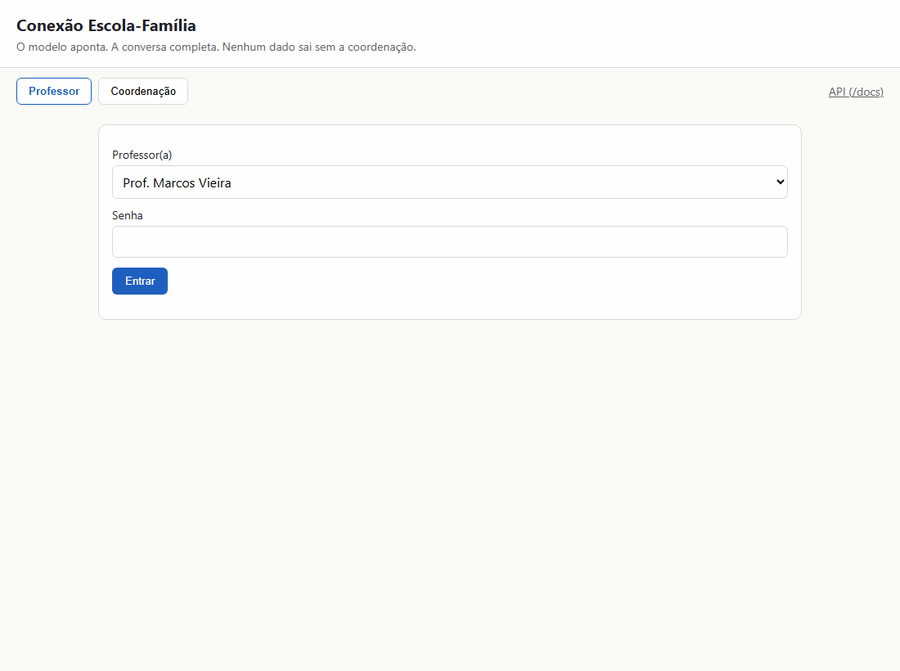

# Conexão Escola-Família (School-Family Connection)

*Português: [README.pt-BR.md](README.pt-BR.md)*


A system for a school to record what teachers observe, prioritize cases in the coordination office, and generate the document for the conversation with the family. A FastAPI service estimates each student's dropout risk with a scikit-learn model.

The code, the screens and the data are in Brazilian Portuguese. This page explains them in English.

## Demo



## Context

There is no such thing as an at-risk student profile: there is observable behavior, and almost always someone notices it first. The system turns that perception into a record: the teacher writes, the coordination office sees the case with data and decides the next step.

Strategy and training references that inspired the workflow (no institutional affiliation):

- [Brazilian Ministry of Education – Escola que Protege](https://www.gov.br/mec/pt-br/escola-que-protege) (SNAVE, Law 14.643/2023).
- [Santa Catarina Military Police](https://www.pm.sc.gov.br): School Safety Network.
- [U.S. Secret Service – NTAC](https://www.secretservice.gov/protection/ntac): *Averting Targeted School Violence* (2021).

## Workflow

| Who | Does | Sees |
|---|---|---|
| Teacher (password) | logs in, picks the class and the student, writes the report and signs it with their full name | the student's record, pass rate and attendance per semester |
| Coordination office (password) | opens the queue and the case box, marks each key as solved or discards it, approves, generates the document | priority (imminent danger first), dropout %, what weighed most, keys from the reports, keys across the school without names, spread of the grade averages, timeline of the calls, year report card, access history |
| Family | receives the invitation to talk | printed document or e-mail, without the list of factors |

## Model

| | |
|---|---|
| Dataset | [UCI 697 – Predict Students' Dropout and Academic Success](https://archive.ics.uci.edu/dataset/697) (4,424 students, CC BY 4.0) |
| Target | 1 = dropped out; 0 = enrolled or graduated |
| Split | 60/20/20 stratified (2654 / 885 / 885), seed 42 |
| Candidates | Logistic regression × HistGradientBoosting, both with `class_weight="balanced"` |
| Chosen | Logistic regression (ROC-AUC difference < 0.02; explainable weights) |
| Test | accuracy 0.872 · F1 (dropout) 0.804 · ROC-AUC 0.924 |
| 1st × 2nd semester averages | Pearson r = 0.837 |

Columns left out for governance: gender, nationality, marital status, special needs, parents' occupation and education, macroeconomic indicators.

Offline training: `python treinar.py` → `models/modelo_evasao.joblib` and `models/metricas.json`.

### Limitations

- The dataset comes from higher education in Portugal, not from basic education in Brazil. Grades go from 0 to 20; the screen converts them to 0 to 10.
- An average of 0 in the dataset means no grade recorded in the semester, not a grade of zero.
- Attendance and enrollment status do not exist in the dataset: in the demo they are made up (`"fonte": "demo"`); in a school, they come from the class diary and the school office.
- The demo students are anonymous rows from the dataset, filtered to ages 17 to 20 (older students are outliers for the project's audience). The model is trained on the full dataset.
- The monthly report card per subject is also a demo: the dataset only has semester averages, so `gerar_boletins_ficticios.py` derives each month's grades and absences around each student's average, share of passed subjects and attendance (`"fonte": "demo"`). The 2026 school year appears in progress, updated on 29/10/2026.
- The teacher's report does not enter the calculation. Risk shows association, not cause.

## Key engine

The teacher's report is free text ("saiu batendo cadeiras", *left banging chairs*; "falou em discurso de ódio", *talked about hate speech*). When it arrives, the engine (`app/chaves.py`) reads the text and returns only the theme of the situation, together with the sentence that triggered it. These are hand-written rules, with no AI, that anyone can read.

| Severity | Keys |
|---|---|
| imminent danger: the case goes to the top of the queue | threat, weapon, talks about self-harm |
| attention | physical conflict, hate speech, dark speech, bullying, isolation, absences, substances, peer company |

- The key describes the situation, never the person. Naming a behavior belongs to the mental health professional, who decides and signs.
- Each key is stored in a key database, separate from the report, and the coordination office marks it as solved, reopens it, or discards it when the engine was wrong. Every change goes to the audit trail.
- The engine does not understand negation: "não bateu em ninguém" (*didn't hit anyone*) still triggers "physical conflict". That is why discarding exists.
- The school view shows how many times each key appeared in each month, with no student name and no report.
- The dropout model does not read the report or the keys.

## Sea and rain: warnings for schools

In Florianópolis, a south swell with high period and energy fills the tide in the mangroves; with heavy rain, it floods and locks up mobility in the city. The coordination office sees the forecast for the next 7 days in the style of a phone weather app (one sentence at the top, the list of days with chance of rain, the weather, high and low, and the day's warning), today's sea, and wave height offshore and at the beach. The week's warning comes out in the same format for printing, and as short text for e-mail.

| Source (public, no key) | What it provides |
|---|---|
| [Open-Meteo Marine](https://open-meteo.com/en/docs/marine-weather-api) | waves offshore and at the beach (Campeche), swell (height, direction, period), sea level |
| [Open-Meteo Forecast](https://open-meteo.com/en/docs) | rain, temperature and the weather for each day |
| [INMET](https://portal.inmet.gov.br) | active weather warnings for Florianópolis (IBGE 4205407) |

| INMET warning | Dashboard level |
|---|---|
| Perigo Potencial (*potential danger*) | attention |
| Perigo, Grande Perigo (*danger, great danger*) | alert |

- The level comes only from official warnings, from today to 2 days ahead. The south swell rule still needs fine-tuning (not every south swell calls for action); until then, sea data is shown but does not trigger an alert.
- The forecast is cached for 3 hours; the "atualizar" (*refresh*) button fetches it again.
- This is the only part of the system that depends on the internet. If a source goes down, the route responds 503 and everything else keeps working. Tests use mocked data, with no network.

## Data protection

- Teacher and coordination passwords are stored only as salted PBKDF2-SHA256 hashes (`hashlib`, no extra dependency).
- The teacher does not receive the prediction; it stays with the coordination office.
- Teachers and coordination log in and receive a temporary pass (2 h, in memory only) that carries the role of whoever logged in; without a pass, routes respond 401, and a teacher pass on coordination routes responds 403.
- The student registry only opens after login. A teacher sees and reports only on students in their own classes; the coordination office sees the whole school.
- A report is only saved when signed: the full name typed must match the logged-in teacher (ignoring case, spacing or title); if it does not match, nothing is saved.
- Audit trail (LGPD, Brazil's data protection law, art. 37): it records, with who and when, every submission, every student who appears in the queue, every opening of a record, history and report card, every approval, every document generated, and every time the coordination office prints the document or opens the e-mail to the guardian. The "who" always comes from the login.
- The trail is append-only: SQLite triggers block updating or deleting a row, even outside the API.
- The model receives only academic numbers, never a name or text.
- All names, e-mails and passwords are fictitious. The database `data/escola.db` is not committed to the repository.

## Structure

```
app/
  main.py               lifespan: model, database, indicators and passes, loaded once
  services.py           inference and factors (weight × value of the logistic regression)
  schemas.py            Pydantic contracts with Field (ranges → 422)
  regras.py             limitations, levels and questions, hand-written
  chaves.py             key engine: the theme of the situation in each report, hand-written
  clima.py              sea and rain: fetches the public sources and sets the level from INMET warnings
  escola.py             SQLite: students, report cards, teachers and their classes, coordination, reports, keys, access
  seguranca.py          PBKDF2 password hashing
  sessoes.py            temporary passes for teachers and coordination
  indicadores.py        semester averages and Pearson r
  routers/
    predicao.py         /health and /v1/predict
    escola.py           teacher, coordination, reports, document, access
    indicadores.py      /v1/indicadores/medias
    clima.py            /v1/clima and the week's warning
web/index.html          teacher and coordination screens (HTML, CSS and JS, no dependencies)
tests/                  API, school workflow, key engine, sea and rain, indicators
gerar_*_ficticios.py    demo data
treinar.py              offline pipeline
```

## Run

```bash
py -m venv .venv
.venv\Scripts\activate
pip install -r requirements.txt
uvicorn app.main:app --reload
```

- Screens: http://127.0.0.1:8000
- Interactive documentation: http://127.0.0.1:8000/docs
- Demo teacher password: `escola2026`; coordination: `coord2026`.

## Endpoints

| Method | Route | Access | Response |
|---|---|---|---|
| GET | `/health` | open | status and whether the model is loaded |
| POST | `/v1/predict` | open | risk, level, factors, limitations, questions |
| GET | `/v1/professores`, `/v1/coordenacao` | open | names for login (no hash) |
| POST | `/v1/professores/login` | teacher password | temporary teacher pass |
| POST | `/v1/coordenacao/login` | coordination password | temporary coordination pass |
| GET | `/v1/alunos` | pass (teacher or coordination) | student registry (a teacher gets only their own classes) |
| POST | `/v1/registros` | teacher pass + full name | only the submission confirmation |
| GET | `/v1/registros`, `/v1/registros/{id}` | coordination pass | queue and record (both log the access) |
| POST | `/v1/registros/{id}/aprovar` | coordination pass | approved report |
| GET | `/v1/registros/{id}/documento?modelo=` | coordination pass | invitation to the family, formalities only (`convite`, or `convite_boletim` with the report card attached) |
| POST | `/v1/registros/{id}/saida` | coordination pass | records that the document was printed or the e-mail was opened |
| GET | `/v1/alunos/{id}/boletim` | coordination pass | year report card: grades per month across two semesters (February to June, August to December), averages, absences and status (logs the access) |
| GET | `/v1/alunos/{id}/chaves` | coordination pass | the student's keys with the report excerpt and status (logs the access) |
| POST | `/v1/chaves/{id}/situacao` | coordination pass | marks the key as open, solved or discarded (goes to the trail) |
| GET | `/v1/indicadores/chaves` | coordination pass | occurrences of each key per school month, with no student name |
| GET | `/v1/alunos/{id}/acessos` | coordination pass | access history (viewing the history also logs the access) |
| GET | `/v1/indicadores/medias` | open | average points and Pearson r |
| GET | `/v1/clima?atualizar=` | coordination pass | sea, tide, rain, temperature and INMET warnings for 7 days, with the dashboard level |
| GET | `/v1/clima/aviso` | coordination pass | short text of the week for the e-mail to teachers and parents |

| Code | When |
|---|---|
| 200 / 201 | success |
| 400 | business rule (passed > enrolled, report already approved, document before approval) |
| 401 | wrong password or no pass |
| 403 | pass from another role, signature name that does not match, or student outside the teacher's classes |
| 404 | student or report not found |
| 422 | invalid type or range (Pydantic) |
| 500 | model not loaded or unexpected failure |
| 503 | sea and rain forecast unavailable (public source down) |

## Tests

```bash
python -m pytest -q
```

GitHub Actions runs the tests on every PR and on every push to `main` and `develop`.

## Workflow

GitFlow: `main` ← `develop` ← `feature/*`, branches kept after merge.
